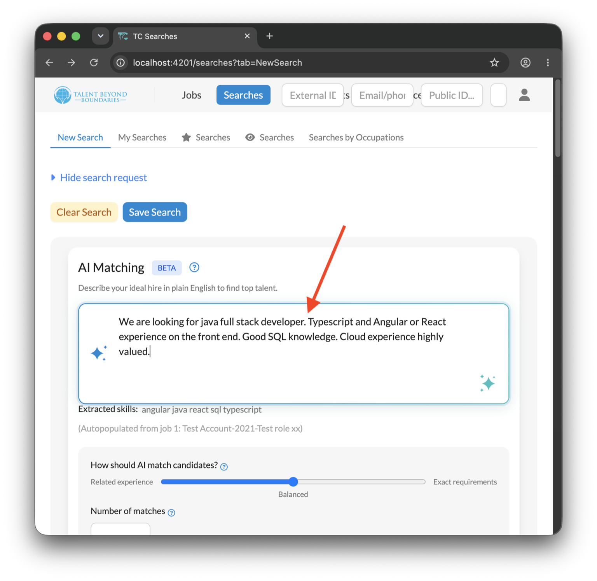
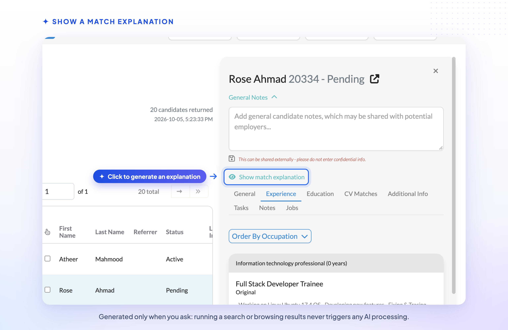
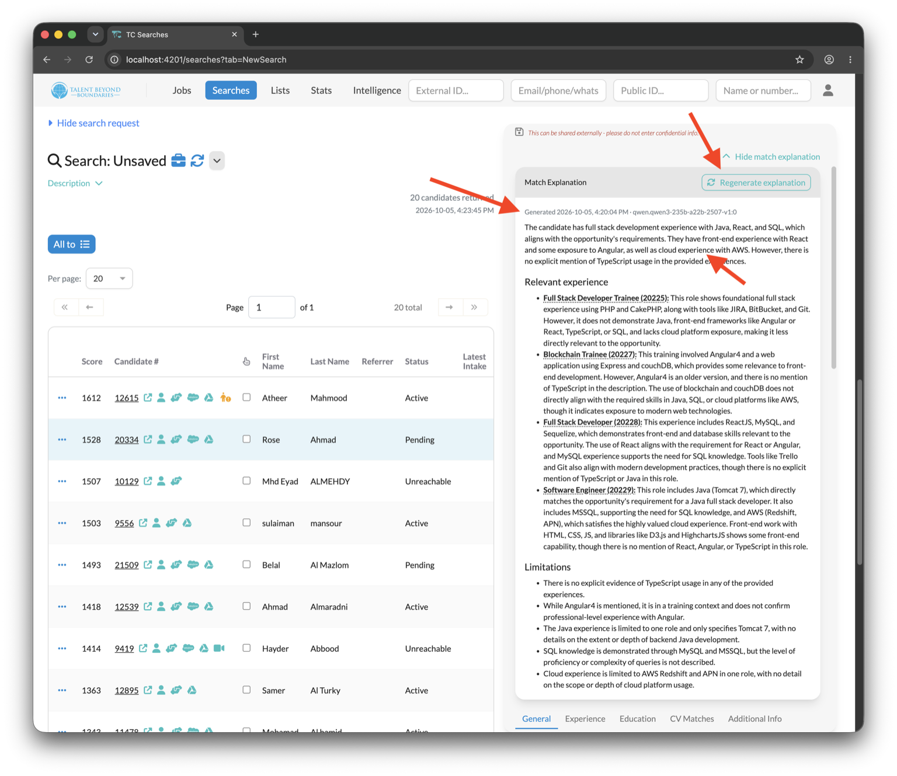
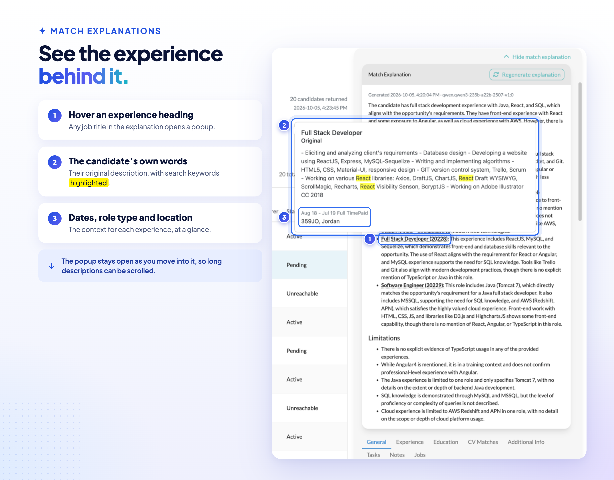
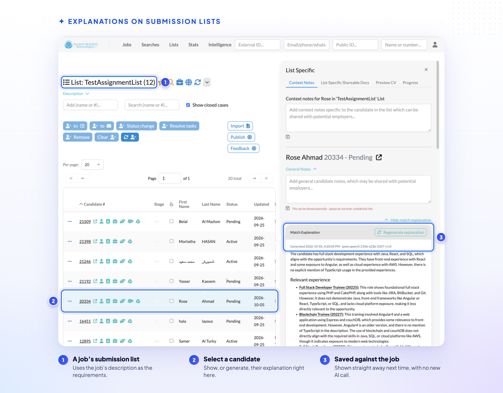

# Match Explanations: Why Was This Candidate Matched?

[v2.6.0](https://talent-catalog.github.io/talentcatalog/v260) brought AI matching online, ranking
candidates by how closely their experience fits a job description. It also promised that users
would be able to see *why* a candidate was matched, not just that they were.

This release delivers that. For any candidate in a matching search, or in a list with matching
requirements such as a job's submission list, Talent Catalog can now generate a plain-English
explanation of how well the candidate's experience fits the requirements — written by a large
language model (LLM).

---

## 📝 Start From the Requirements

Explanations compare a candidate against the **AI match requirements** text on the search screen.
That might be a job description pulled in from a job (as in the example above), or anything you
type yourself describing the experience you're looking for.

Explanations always use the requirements as last saved, not unsaved edits. If you change the
requirements, run the search (or, for a named search that doesn't update automatically, save
it) before showing explanations — until then Talent Catalog tells you that the requirements have
changed instead of showing an explanation of the old ones.

## 👁️ Show a Match Explanation

Select a candidate in the search results and click **Show match explanation**.

Explanations are only generated when you ask for one, so simply running a search or browsing
results never triggers any AI processing.

## 💡 What an Explanation Contains

Each explanation includes:

- **A summary** of how well the candidate matches overall.
- **Relevant experience** — a separate assessment of each of the candidate's job experiences,
  headed by that experience's job title.
- **Limitations** — what the candidate's experience doesn't show, or where the information is
  too thin to judge.

Explanations are dated, and show the name of the LLM that generated them (a Qwen model in this
case).

Click **Regenerate explanation** to generate a fresh one — for example after the candidate has
updated their experience. Changes to the requirements are picked up automatically (see below),
but changes to a candidate's experience are not yet.

Both parts of our hybrid approach bring general world knowledge to the comparison. In this example
the candidate never actually mentioned “cloud” experience, but she did mention AWS. The vector
embeddings that made the match knew that AWS is a cloud platform, and so did the LLM that
explained it. The embeddings find the right candidates quickly across the whole database, and the
LLM then explains each match in plain language, so each does the job it’s best at rather than
asking an LLM to do everything.

## 🔎 See the Experience Behind Each Explanation

Hover over any experience heading to see the candidate's own description of that experience,
including dates, role type and location, with search keywords highlighted. The popup stays open
while you move into it, so long descriptions can be scrolled.

## 📋 Saved, Shared and Kept Up to Date

Each explanation is saved for the candidate and the requirements it explains. Next time anyone
shows the explanation for that candidate — from the same search or list, or from any other
search or list sharing the same requirements — the saved explanation is displayed straight away,
with no new AI call.

All the searches and lists associated with a job share the job's requirements, so an explanation
generated from a job search is also shown on the job's submission list (as above), and vice
versa. Searches and lists that aren't associated with a job work just the same, using their own
requirements. (A list without a job gets requirements when candidates are saved into it from a
search with requirements.)

When the requirements change, saved explanations of the old requirements are no longer shown.
Instead, a fresh explanation is generated from the new requirements the next time one is shown,
and replaces the old one.

A job's submission list uses the job's description as its requirements until someone refines
them in a job search.

## ⚠️ A Word of Caution

Match explanations are generated by AI. They are a quick way to understand a candidate's fit,
but they can misread or overlook information. Use them as a guide alongside the candidate's
profile, not as a substitute for reviewing it.

## ⚙️ Under the Hood

- Explanations are generated by the Talent Catalog AI service, currently using the open-weight
  **Qwen3 235B** model. The cost is roughly 30 explanations per US cent.
- Only the requirements text and the candidate's job experience (job title and description) are
  sent to the LLM — not the candidate's name, contact details or other profile information.
- Explanations are a disposable cache, not a history: at most one explanation is kept per
  candidate and set of requirements, recording when it was generated and which model generated
  it. Regenerating an explanation, or generating one from changed requirements, replaces it.
- The requirements are always read on the server from the saved requirements — never taken from
  the browser. An explanation generated while the requirements were being changed is discarded
  rather than saved, so it can never replace an explanation of the new requirements.
